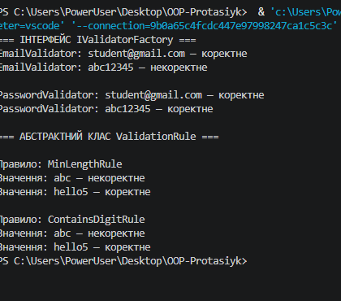

# Лабораторна робота №10

Тема: Абстрактні класи та інтерфейси. Контракти та реалізації.

Варіант 20. IValidatorFactory та ValidationRule.

## Мета роботи

Навчитися використовувати інтерфейси й абстрактні класи для реалізації контрактів, спільної логіки та поліморфізму в C#.

## Хід роботи

1. Створено консольний проєкт `lab10v20`.
2. Реалізовано інтерфейси `IValidator<T>` та `IValidatorFactory<T>`.
3. Створено фабрики `EmailValidatorFactory` і `PasswordValidatorFactory`.
4. Реалізовано абстрактний клас `ValidationRule<T>` та похідні класи `MinLengthRule` і `ContainsDigitRule`.
5. У методі `Main` продемонстровано поліморфні виклики через колекції інтерфейсів і абстрактного класу.

## Результат роботи

Програма перевіряє електронну пошту, пароль, мінімальну довжину рядка та наявність цифр.

## Скріншот виконання

