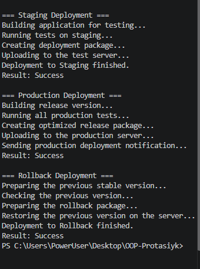

# Лабораторна робота №11

Тема: DocumentProcessor: шаблонні кроки й реалізації.

Варіант 20. DeploymentPipeline.

### Мета роботи
Навчитися використовувати патерн Template Method та абстрактні класи в C#.

### Хід роботи
1. Створено проєкт `lab11v20`.
2. Реалізовано клас `DeploymentPipeline` із шаблонним методом `Deploy()`.
3. Створено класи `StagingDeploy`, `ProductionDeploy`, `RollbackDeploy`.
4. Перевірено роботу програми в консолі.

### Скріншот виконання
Вставити скриншот результату `dotnet run`.

### Контрольні питання

1. Template Method визначає послідовність кроків алгоритму.
2. Абстрактний клас задає спільну структуру для похідних класів.
3. `abstract` не має реалізації, а `virtual` має базову реалізацію.
4. Шаблонний метод викликає кроки алгоритму в заданому порядку.
5. Переваги: повторне використання коду та зручність розширення програми.

### Висновок
Реалізовано патерн Template Method, абстрактний клас, наслідування та поліморфізм у C#.
###  скріншот
