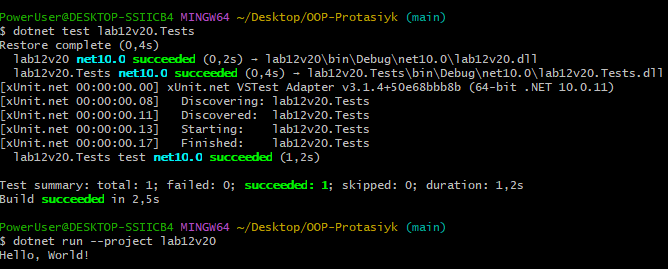
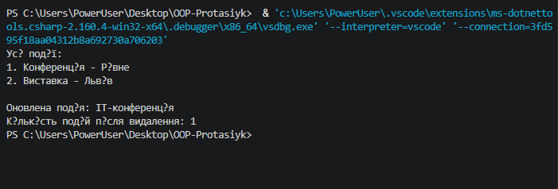

# Лабораторна робота №12

Тема: Узагальнені типи (Generics). IRepository з where-обмеженнями та тестами.

## Мета роботи

Навчитися створювати узагальнені інтерфейси та класи, використовувати where-обмеження й писати юніт-тести.

## Хід роботи

1. Створено інтерфейс IEntity з властивістю Id.
2. Реалізовано узагальнений IRepository<T> з обмеженням where T : IEntity.
3. Створено InMemoryRepository<T> для виконання CRUD-операцій.
4. Створено сутність Event з властивостями Name, Location і EventDate.
5. Написано юніт-тести для перевірки додавання, пошуку, отримання, оновлення та видалення елементів.
6. Перевірено роботу програми та тестів.

## Структура проєкту

- lab12v20 — основна програма.
- lab12v20.Tests — проєкт юніт-тестів xUnit.

## Перевірка

## Результат виконання

