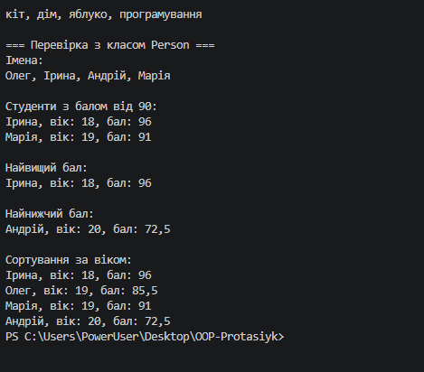

# Лабораторна робота №13

Тема: Generic-методи для повторного використання компонентів.

Варіант: 20

## Мета роботи

Навчитися створювати узагальнені методи C# та використовувати делегати для обробки колекцій.

## Виконання роботи

Створено клас `FunctionalUtils` із п'ятьма generic-методами:

1. `Map` — перетворення елементів списку.
2. `Filter` — фільтрація елементів за умовою.
3. `MaxBy` — пошук елемента з максимальним значенням.
4. `MinBy` — пошук елемента з мінімальним значенням.
5. `OrderBy` — сортування елементів за ключем.

Для перевірки створено клас `Person` і тестові дані типів `int`, `string` та `Person`. Використано `Func`, `Predicate` і обмеження `IComparable<TKey>`.

## Результат роботи

Програму успішно запущено. Перевірено роботу всіх п'яти методів на різних типах даних.

## Скріншот виконання

## Висновок

Під час лабораторної роботи освоєно створення generic-методів, використання делегатів і лямбда-виразів для повторного використання коду та обробки колекцій.
