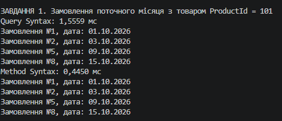
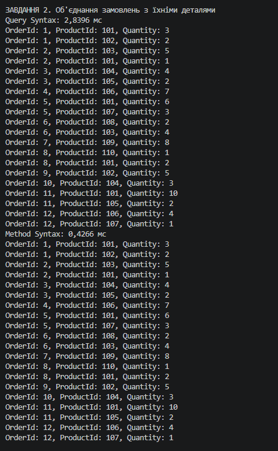
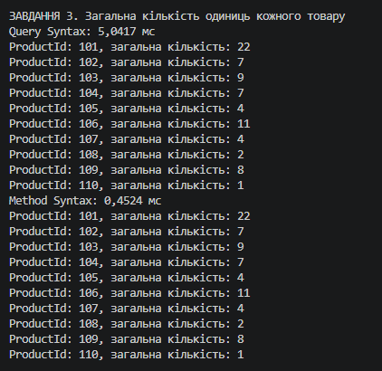
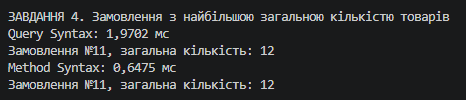
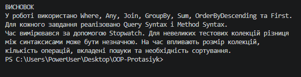

# Лабораторна робота №15

## Тема: LINQ в дії: фільтри, join, агрегації. Продуктивність

**Варіант:** 20

## Хід роботи

1. Створено консольний проєкт `lab15v20`.
2. Створено класи `Order` та `OrderDetail`.
3. Додано тестові дані.
4. Реалізовано 4 завдання з використанням LINQ:
   - Фільтрація замовлень.
   - Об'єднання через `Join`.
   - Групування через `GroupBy` та підрахунок через `Sum`.
   - Пошук замовлення з найбільшою кількістю товарів.
5. Використано Query Syntax і Method Syntax.
6. Виміряно час виконання за допомогою `Stopwatch`.

## Результат

Усі завдання виконано та перевірено.
завдання 1

завдання 2

завдання 3

завдання 4

## Висновок

Навчився використовувати LINQ для фільтрації, об'єднання та агрегації даних, а також вимірювати продуктивність запитів за допомогою Stopwatch.

