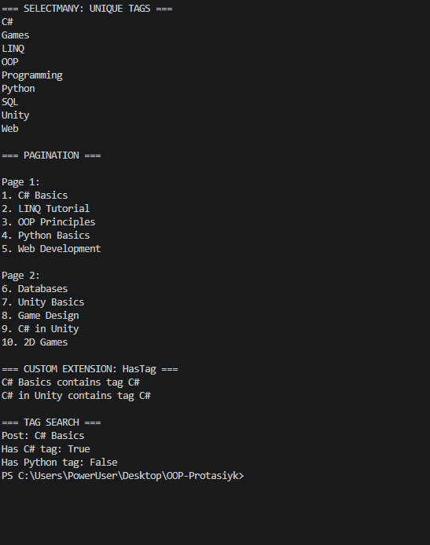

# Лабораторна робота №16

**Тема:** LINQ: SelectMany, пагінація й custom extensions.

**Варіант:** 20

## Хід роботи

1. Створено консольний проєкт `lab16v20`.
2. Створено класи `Blog`, `Post` та `Tag`.
3. Реалізовано `SelectMany` для отримання унікальних тегів.
4. Реалізовано пагінацію постів по 5 елементів за допомогою `Skip()` і `Take()`.
5. Створено метод розширення `HasTag()` для перевірки наявності тегу.
6. Перевірено роботу програми в консолі.

## Результат роботи

## Висновок

Навчився використовувати SelectMany, реалізовувати пагінацію та створювати власні методи розширення в C#.