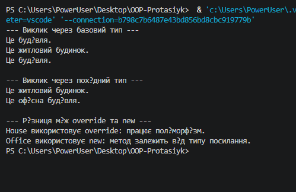

# Лабораторна робота №7

**Тема:** Приховування методів (`new`) vs перевизначення (`override`).

**Варіант 20. Ієрархія Building → House / Office**

- Базовий клас: `Building`.
- Похідний клас: `House`, який перевизначає метод `Describe()` за допомогою `override`.
- Похідний клас: `Office`, який приховує метод `Describe()` за допомогою `new`.

# Хід роботи:

У ході виконання лабораторної роботи №7 я створив консольний проєкт на C# за допомогою команди `dotnet new console`. Реалізував базовий клас `Building` та два похідні класи: `House` і `Office`.

Клас `House` перевизначає метод `Describe()` за допомогою `override`, а клас `Office` приховує його за допомогою `new`. У методі `Main()` продемонстровано виклики методів через посилання базового та похідних типів, щоб показати різницю між перевизначенням і приховуванням методів.

# Результат роботи:

Місце для скриншота запуску програми:

![Скріншот запуску програми]
